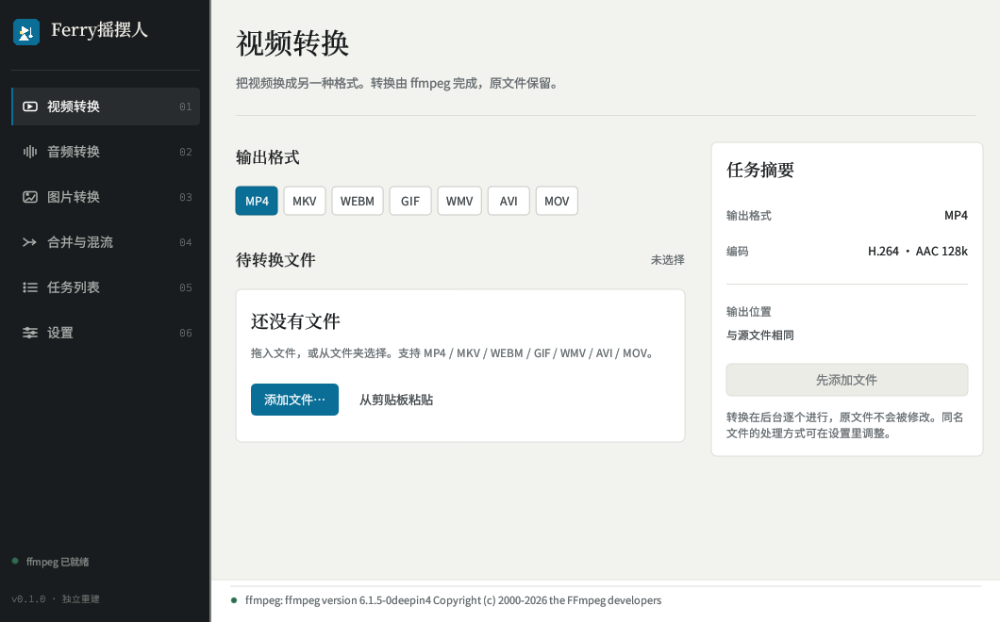
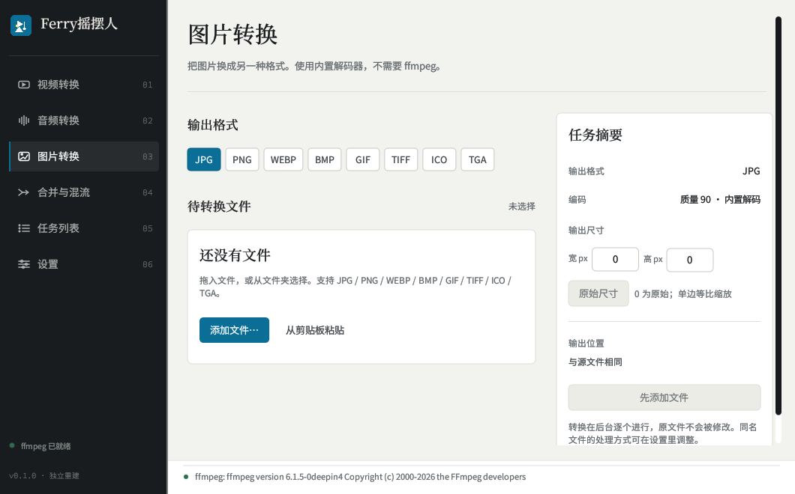
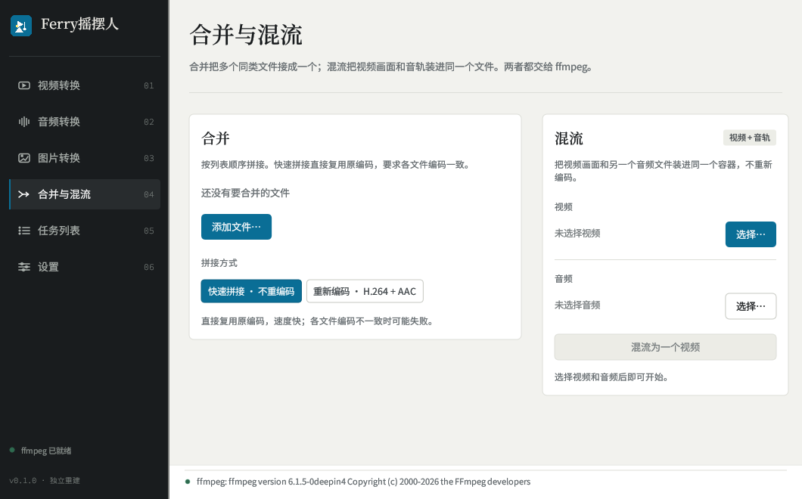

# Ferry摇摆人

一个 Linux 优先的桌面媒体转换工具，使用 Rust + egui 编写。把视频、音频、图片批量换成另一种格式，也可以合并、混流。视频和音频交给 ffmpeg，图片使用内置解码器。



## 为什么做这个

格式工厂在 Windows 上很常用，但 Linux 上没有顺手的对应工具。Ferry 是一个独立重写的替代品，界面更简单，转换参数按常见 ffmpeg 默认值设置。项目不包含原软件的代码，原始安装包只做过静态研究，详情见 [`app/MECHANICS.md`](app/MECHANICS.md)。

## 功能

- **视频转换**：MP4、MKV、WebM、GIF、WMV、AVI、MOV，默认 H.264 + AAC。
- **音频转换**：MP3、WAV、AAC、FLAC、OGG、M4A，三档音质。
- **图片转换**：JPG、PNG、WebP、BMP、GIF、TIFF、ICO、TGA，内置解码，不依赖 ffmpeg。
- **图片输出尺寸**：可设置宽高，0 表示原始尺寸；只填一边时按比例缩放。
- **合并与混流**：多个同类文件拼接，或把视频画面和音轨装进同一个文件。
- **任务队列**：后台逐个转换，状态、尺寸和失败原因都显示在队列里。
- **文件拖放**：把文件拖进窗口即可加入当前页面。
- **本地配置**：输出目录、同名处理和默认音质保存在 `~/.config/ferry/ferry.json`。

## 界面

| 图片转换 | 合并与混流 |
| --- | --- |
|  |  |

界面使用深墨色导航栏、纸白工作区和一个取自品牌图标的青蓝色强调色。设计说明在 [`app/UI-DESIGN.md`](app/UI-DESIGN.md)。

## 安装

### 下载 deb

从 [Releases](https://github.com/carnothuang/ferry/releases) 下载 `ferry_0.1.0_amd64.deb`，然后：

```bash
sudo apt install ./ferry_0.1.0_amd64.deb
```

运行依赖：`ffmpeg`、`zenity`、`xclip`。Debian/Ubuntu 会自动安装。

### 从源码构建

需要 Rust 1.75 或更新版本：

```bash
cd app
cargo build --release
./build-deb.sh
```

生成的 deb 位于 `app/deb/ferry_0.1.0_amd64.deb`。

直接运行：

```bash
cd app
./target/release/ferry
```

## 使用

1. 在左侧选择视频、音频或图片页面。
2. 添加文件，或者把文件拖进窗口。
3. 选择输出格式。图片页还可以填写输出宽高。
4. 点击“转换 N 个文件为 XXX”。任务会进入队列，原文件不会被修改。

图片尺寸规则：

- 宽高都是 0：保持原始尺寸。
- 只填宽或只填高：按比例缩放。
- 宽高都填：精确缩放到指定尺寸。
- 单边最大 12000 px。
- ICO 固定输出单帧 256 px。

## 项目结构

```text
app/
  src/main.rs       应用入口、配置、任务模型、图标和字体
  src/ui.rs         全部界面与组件
  src/engine.rs     ffmpeg 任务调度
  src/imaging.rs    图片转换与缩放
  src/tools.rs      文件选择器、ffmpeg 探测
  build-deb.sh      deb 打包脚本
  UI-DESIGN.md      界面设计方向
  MECHANICS.md      编码参数与验证记录
.opencode/skills/   项目使用的 no-ai-slop 设计技能
AGENTS.md           开发约定
```

## 开发

```bash
cd app
cargo fmt
cargo build --release
cargo clippy --release
```

逐页截图检查：

```bash
./target/release/ferry --page video --screenshot /tmp/video.png
./target/release/ferry --page image --screenshot /tmp/image.png
./target/release/ferry --page tools --screenshot /tmp/tools.png
./target/release/ferry --page settings --screenshot /tmp/settings.png
./target/release/ferry --page video --size 880x560 --screenshot /tmp/narrow.png
```

无显示环境可以套一层 `xvfb-run -a -s "-screen 0 1200x800x24"`。

## 说明

- 视频、音频、合并和混流需要系统安装 `ffmpeg`。
- 图片转换使用 `image` crate，不需要 ffmpeg。
- 输出命名默认为 `原文件名_格式.扩展名`；同名文件默认覆盖，可在设置里改为自动改名或跳过。
- Linux 任务栏图标通过 X11 的 `_NET_WM_ICON` 设置；Wayland 下使用 `app_id` 和桌面文件关联。
- 本项目是独立重建，不包含原软件的代码或资源。

## 致谢

- [egui / eframe](https://github.com/emilk/egui)
- [image](https://github.com/image-rs/image)
- [FFmpeg](https://ffmpeg.org/)
- [unslop-ui-skill](https://github.com/claudiusararu/unslop-ui-skill)，MIT
- 思源黑体 / 思源宋体、Noto CJK

## License

MIT，见 [LICENSE](LICENSE)。
